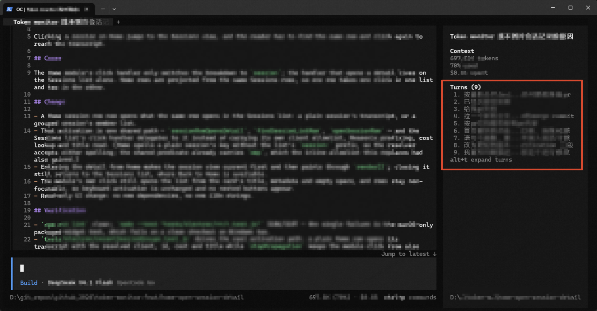
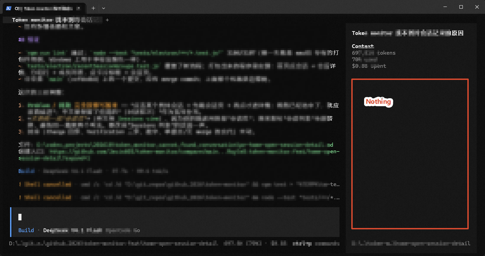

# Turn Navigator

简体中文 | [English](README.en.md)

一个 OpenCode 终端界面（TUI）插件，用于浏览会话轮次、查看上下文压缩信息，并在对话记录中跳转。

```text
Alt+T       打开或关闭完整轮次面板
/turns      在输入框执行同一操作
<leader>b   用主机的绑定显示或隐藏侧栏
```

## 效果演示

### 安装插件后



### 未安装插件



## 安装

插件只需要 `tui.tsx` 和 `turns.ts`。下面的命令用 `--sparse` 稀疏克隆，一次粘贴即可装好，通常几秒完成：只下载这两个源码文件，README、截图等不会取回；目录同时是完整的 git 仓库，之后可直接用 `git pull --ff-only` 更新。安装后通常无需重启 OpenCode；当前会话没有显示时，切换会话再看一次。

### 方式一：让智能体安装

把下面的提示词发给可操作终端的 OpenCode 智能体，插件会装到全局目录（所有项目可用）：

```text
请从 https://github.com/Rayle8/opencode-turn-navigator 安装 OpenCode Turn Navigator，并放入当前用户的全局 OpenCode 插件目录（macOS / Linux：~/.config/opencode/plugins/turn-navigator；Windows：%USERPROFILE%\.config\opencode\plugins\turn-navigator）。用 `git clone --depth 1 --filter=blob:none --sparse` 加 `git sparse-checkout set --no-cone /tui.tsx /turns.ts` 安装，只检出 tui.tsx 和 turns.ts，并保留 .git 以便日后更新。装完用 `opencode plugin list` 确认，并告诉我如何在界面里确认插件已加载。
```

### 方式二：手动执行命令

#### 全局安装（所有项目可用）

| 系统 | 插件目录 |
| --- | --- |
| macOS / Linux | `~/.config/opencode/plugins/turn-navigator/` |
| Windows | `%USERPROFILE%\.config\opencode\plugins\turn-navigator\` |

macOS / Linux：

```sh
mkdir -p ~/.config/opencode/plugins
git clone --depth 1 --filter=blob:none --sparse --branch main https://github.com/Rayle8/opencode-turn-navigator.git ~/.config/opencode/plugins/turn-navigator
git -C ~/.config/opencode/plugins/turn-navigator sparse-checkout set --no-cone /tui.tsx /turns.ts
```

Windows PowerShell：

```powershell
New-Item -ItemType Directory -Force "$env:USERPROFILE\.config\opencode\plugins" | Out-Null
$pluginDir = "$env:USERPROFILE\.config\opencode\plugins\turn-navigator"
git clone --depth 1 --filter=blob:none --sparse --branch main https://github.com/Rayle8/opencode-turn-navigator.git $pluginDir
git -C $pluginDir sparse-checkout set --no-cone /tui.tsx /turns.ts
```

> PowerShell 5.1 会把 git 的进度输出（例如 `Cloning into ...`）当成错误显示成红字和 `NativeCommandError`。这不代表失败：只要 `$LASTEXITCODE` 为 0、目录里出现这两个文件，就说明装好了。

#### 仅在当前项目安装

在项目根目录执行：

```sh
mkdir -p .opencode/plugins
git clone --depth 1 --filter=blob:none --sparse --branch main https://github.com/Rayle8/opencode-turn-navigator.git .opencode/plugins/turn-navigator
git -C .opencode/plugins/turn-navigator sparse-checkout set --no-cone /tui.tsx /turns.ts
```

更新全局安装：`git -C ~/.config/opencode/plugins/turn-navigator pull --ff-only`；项目安装把路径换成 `.opencode/plugins/turn-navigator`。卸载只需删除该目录，然后重开 TUI。

OpenCode 会从全局插件目录 `~/.config/opencode/plugins/`（Windows：`%USERPROFILE%\.config\opencode\plugins\`）和项目目录 `<项目根目录>/.opencode/plugins/` 自动发现本地插件，无需修改 `opencode.json`，也无需安装依赖或构建。

### 确认插件已加载

先看插件列表：

```sh
opencode plugin list
# 期望输出包含 turn-navigator，SOURCE 为 local
```

再打开或切换到可显示侧栏的会话：侧栏应出现 `Turns` 区块，底部有 `alt+t expand turns` 提示；按 `Alt+T` 可打开完整列表，`↑` / `↓` 移动、`Enter` 跳转、`Escape` 关闭。仍未出现时重开一次 TUI；排查时查看 `~/.local/share/opencode/log/opencode.log`（Windows：`%USERPROFILE%\.local\share\opencode\log\opencode.log`）。

## 使用说明

### 插件显示位置

- **侧栏（默认）**：在支持侧栏的终端中，`Turns` 区块显示在会话标题、Context、todo 和 MCP 信息之后，按时间顺序列出当前已加载的轮次，最新轮次位于底部。列表会使用剩余侧栏高度；轮次数超过可见行数时可滚动。列表下方固定显示 `alt+t expand turns` 提示。点击 `Turns` 标题左侧的三角形可折叠或展开区块，选择会被记住，无需启用额外选项。
- **完整轮次面板**：按 `Alt+T` 在右侧打开所有已加载轮次，按从旧到新的顺序排列，适合较窄的终端或较长的会话。用 `↑` / `↓` 移动，`Home` / `End` 跳到首项或末项，`Enter` 跳转，`Escape` 关闭。上次选择的行会被记住并滚动到可见区域。

压缩消息显示在轮次之间。下一步 assistant 回复报告压缩结果后，压缩行会显示节省的上下文量，例如 `compact · saved 82.3k (68%)`；正在进行时显示 `compact · running`，失败或取消时显示对应状态。悬停压缩行可查看压缩前后的上下文量、节省值和比例、该压缩请求自己的 token 用量与费用，以及摘要或错误信息。在下一步 assistant 回复到达前，插件会显示压缩前的上下文量和省略号，不会提前估算收益。

点击压缩行会跳到它附近最近的可导航消息（如果存在，通常是压缩前的消息），因为 OpenCode 的消息导航不包含压缩行本身。

两种视图都会显示轮次编号和提示词预览；压缩行使用 `⇣` 标记。悬停轮次可查看完整提示词，悬停压缩行可查看压缩详情。浮动提示框保留换行，不会改变行高或滚动位置；它以被悬停的标题为垂直中心，并始终限制在会话面板范围内，最小高度为 5 行（含边框），随内容增高到会话面板高度，超出部分可滚动并显示滚动条。提示框上边框右侧以浅色显示 `Unpinned` 或 `Pinned`，不占用额外行，也没有锁图标。带用量数据的轮次会在提示框头部显示摘要：`Session` 行给出从会话开始到该轮的累计 token 用量、缓存命中量、累计费用，以及该轮结束时的上下文剩余百分比；`Turn` 行给出该轮的总 token、新增 token、缓存 token（含占比）、步数、费用和 TPS；有缓存失效时另起一行显示次数（`cache bust`：某一步的缓存命中量低于上一步，说明缓存前缀失效、这部分 token 按新输入计费）。提示词显示在其下。指针在同一行停留 300 毫秒后提示框固定；移入提示框会立即固定，保持当前内容并允许滚动。划过其他行不会立即切换，需要在新行停留 220 毫秒后内容才会替换。固定后离开该行仍保持打开，直到点击提示框外部或停留在另一行。

会话运行期间，最新轮次行尾会显示一个单格方框，每 280 毫秒按顺时针点亮一条边（`▀`、`▐`、`▄`、`▌`），形成流动效果。会话空闲后方框消失。展开面板宽度足够时还会显示时间，以及回复数和工具调用数。

### 跳转方式

OpenCode 的 TUI 插件 API 没有提供滚动对话记录的接口，而且对话记录采用虚拟化渲染。因此，插件使用 OpenCode 公开的消息导航命令：

1. `session.messages_last_user` 先跳到最新的用户提示词，使所有已加载消息行进入渲染，并设置当前消息。
2. 短暂等待界面稳定后，针对所选轮次之后的每个用户提示词调用一次 `session.message.user.previous`，使该提示词定位到对话区域顶部。

普通点击或按 `Enter` 会停在提示词处。在任一视图中按住 `Ctrl` 点击，还会按主机导航命令可定位到的回复消息数量调用 `session.message.next`，最终定位到该轮次最后一条文本回复。没有文本回复的轮次会停在提示词处。

点击压缩行时，插件同样从最新用户提示词开始，然后使用 `session.message.previous` 或 `session.message.next` 找到最近的用户或 assistant 消息边界。OpenCode 的边界列表不包括压缩行，因此通常会定位到压缩前的 assistant 回复。

侧栏跳转时不会打开弹窗，因此不会闪烁；侧栏也不会接管会话输入，跳转后会保持打开。完整轮次面板会接管输入，这会禁用会话命令，因此跳转前面板会关闭。跳转后不会自动重开面板，因为重新布局会改变对话区域宽度并移动已定位的轮次。按 `Alt+T` 可在上次选择的位置重新打开。

如果主机版本变更导致这些导航命令不可用，插件会显示提示。
